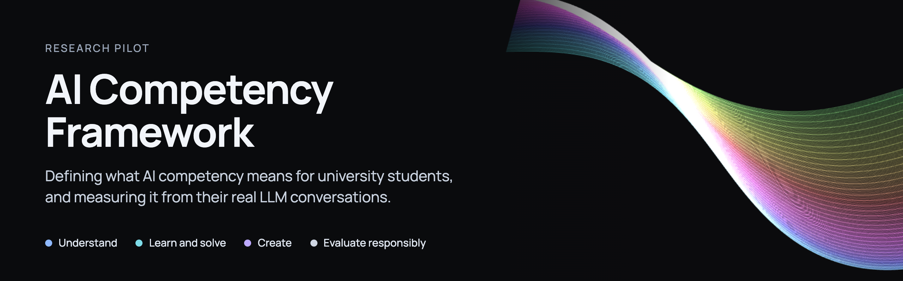

<p align="center">
  
</p>

How good are university students at working with AI? Most surveys ask students to rate themselves, which tells you what they believe rather than what they can do. This project tries to do better in two ways.

First, it defines what AI competency actually means for a student: 25 capabilities grouped under four domains. Second, it tests whether we can see those capabilities directly in the conversations students have with tools like ChatGPT, Gemini and Claude, and score them automatically.

The work is a research pilot at the National University of Singapore.

## The framework

The 25 capabilities fall under four domains:

- **Understand AI:** how AI works, what it can and can't do, and when to use it.
- **Learn and Solve with AI:** using AI to learn something and reason through a problem.
- **Create with AI:** planning, directing and finishing real work with AI.
- **Evaluate and Use AI Responsibly:** checking claims, weighing harm and owning the final decision.

The full definitions are in [capabilities.md](capabilities.md).

## What a student does

The whole assessment takes about an hour, and it runs in this order:

1. **Self-assessment.** The student rates themselves on all 25 capabilities.
2. **Quiz.** 25 scenario questions, one per capability.
3. **Learning task.** The student studies a short lecture deck on memory and attention, however they normally would, and shares their AI transcript if they used an LLM.
4. **Creation task.** The student either writes a short essay or solves a small coding problem, and again shares their transcript.

At the end they see an analysis of their strengths and improvement areas across the four domains.

## What's in this repo

| Folder | What it holds |
| --- | --- |
| [`material/`](material) | The quiz, the self-assessment, the three task briefs and the lecture deck. The portal reads directly from here. |
| [`portal/`](portal) | The web app students use, including scoring and a reviewer screen. Its [README](portal/README.md) explains how to run it. |
| [`student-runs/`](student-runs) | Where finished assessments get saved for analysis. Student data stays on your machine and is never committed. |

## Try it

You need Node 22.13 or newer.

```sh
cd portal
npm install
npm run dev
```

Then open http://localhost:4173. It starts in demo mode unless a `.env` file says otherwise, so you can click through everything without API keys and nothing leaves your computer.
